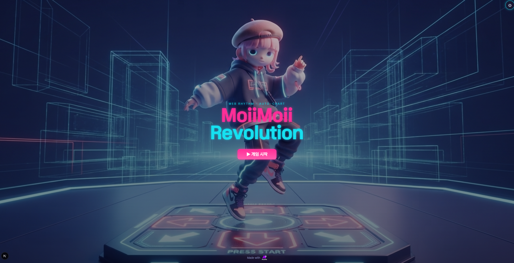
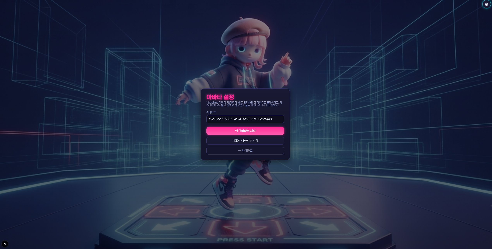
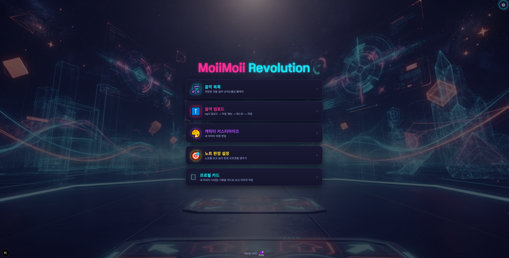
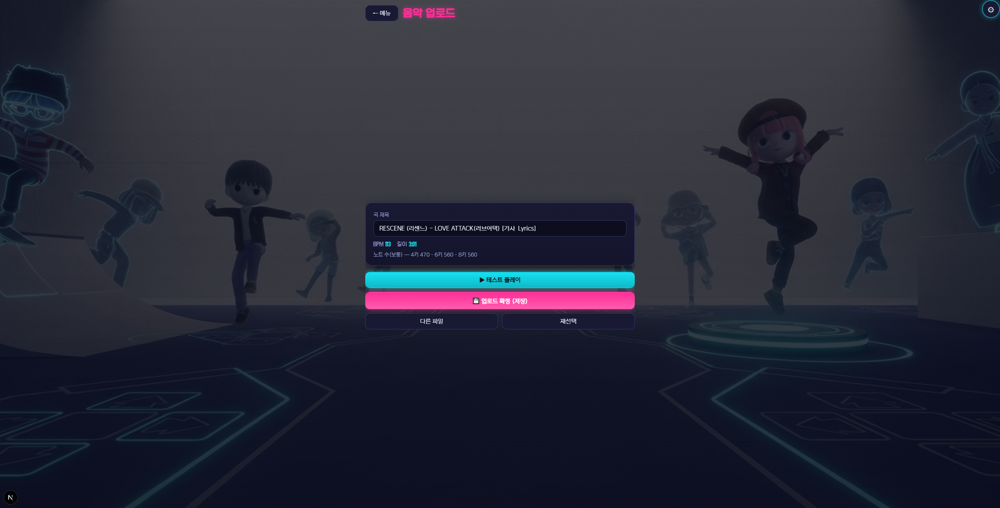

# MoiiMoii Revolution

mp3 파일 하나만 넣으면 **알고리즘이 자동으로 채보(노트)를 생성**하는 웹 리듬 게임. Moiime 아바타가 무대 뒤에서 춤추고, 키를 누를 때마다 포즈를 취한다. [Moiime SDK](https://moii.me/) 데모.

   

## 실행 준비 (Windows)

1. [Releases](../../releases)에서 `MoiiMoiiRevolution-<버전>-windows.zip`을 받아 압축 해제
2. [moii.me](https://moii.me/)에서 **API 키(mk_pub_…)**와 **캐릭터**를 만든다
3. 키의 허용 도메인에 **`http://localhost:8701`**를 추가
4. `play.bat` 실행 → 처음 한 번 키와 캐릭터 ID를 물어보고, 브라우저에서 게임이 열린다

입력한 값은 압축을 푼 폴더의 `moiime.config.json`에만 저장된다. 바꾸려면 `reset-keys.bat`. 배포 파일에는 어떤 키도 들어 있지 않다.

## 게임

- **자동 채보**: 올린 mp3를 브라우저에서 분석(온셋 · 템포 · 비트 그리드)해 키 수 × 난이도별 채보를 즉석 생성. 음원은 외부로 보내지 않는다
- **4 · 6 · 8키 × 쉬움 · 보통 · 어려움**, 기본 곡 8곡 포함
- 롱 노트, 노트 속도 · 볼륨 · 판정 오프셋 보정
- 판정 Perfect ≤ 45ms · Good ≤ 110ms, 100만 점 만점 · 등급 SSS~D
- 곡 + 채보 내보내기 · 가져오기(`.mmr.json`), 프로필 카드 PNG 저장
- 기록 · 음원은 브라우저에만 저장

| 키 수 | 키 |
|---|---|
| 4키 | `D` `F` `J` `K` |
| 6키 | `S` `D` `F` `J` `K` `L` |
| 8키 | `A` `S` `D` `F` `J` `K` `L` `Space` |

`Esc`: 플레이 중단. 모바일은 화면 하단 레인을 터치.

---
Made with [Moiime SDK](https://moii.me/)
